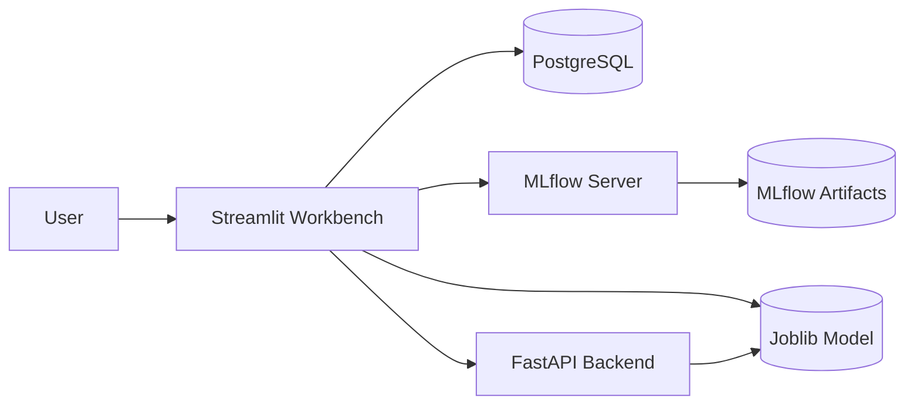

# System Architecture

## Components

- **Streamlit:** User interface for uploading datasets, EDA, cleaning, feature engineering, training, evaluation, explanation, SQL, and prediction.
- **FastAPI:** REST API for model metadata, single predictions, and batch predictions.
- **PostgreSQL:** Persistent storage for datasets and SQL analytics.
- **MLflow:** Experiment metadata and model/artifact tracking.
- **Joblib:** Serialization format for the latest trained model bundle.
- **Docker Compose:** Runs the application services in an isolated network.

